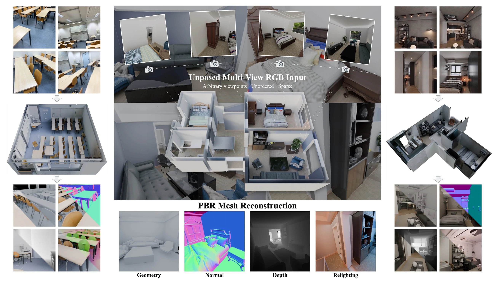
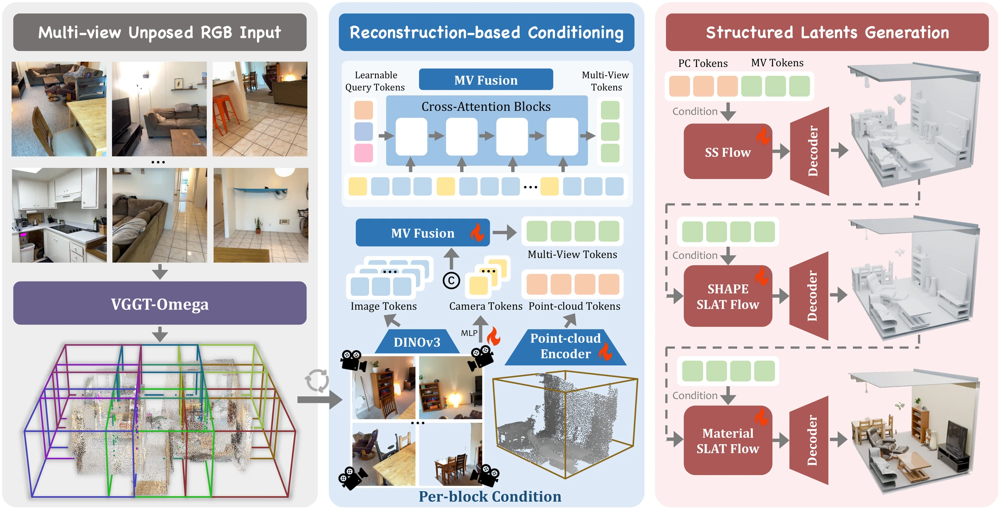

# WorldRecon: Generative Multi-View Mesh Reconstruction for Large-Scale 3D World

  
  
  

  

## News

- 2026.10.14: The project page and paper are available: [Project Page](https://kszpxxzmc.github.io/WorldRecon-website/) | [Paper](https://kszpxxzmc.github.io/WorldRecon-website/WorldRecon.pdf).

## Method

  

## Citation

